# Weather-Index Insurance on Ethereum: The Sokoto Rainfall Cover Platform

**BSc Software Engineering Capstone Project**

Chinemerem Judith Ugbo · Supervisor: Dr Aaron Izang

African Leadership University

October 2026

---

## Abstract

Smallholder farmers in Sokoto State, Nigeria, lose their harvests to drought with no
reliable way to insure against them: traditional crop insurance needs loss assessors,
paper claims and weeks of waiting, which makes it uneconomic at smallholder scale.
*Weather-index insurance* replaces all of that with a rainfall measurement — if rainfall
during the coverage period falls below a threshold agreed at purchase, the farmer is paid
automatically. The problem moves from assessing losses to trusting the rainfall number.
This project builds **Sokoto Rainfall Cover**, a decentralised application that settles
weather-index insurance on the Ethereum test network (Sepolia) using smart contracts, and
answers the trust question with three independent rainfall sources — CHIRPS, NASA POWER
and Meteostat — aggregated by a reputation-weighted consensus so that no single source can
decide a claim. The system comprises two Solidity contracts (insurance and oracle
aggregation), an Express/TypeScript backend running an oracle relayer, settlement keeper
and notification service, and a React frontend with separate farmer, field-agent and
administrator portals. Farmers can buy cover themselves from a wallet, or through a field
agent who collects the premium in naira; payouts are pushed automatically to the policy
holder's wallet at settlement, so no claim is ever filed. The test suite runs 280 tests —
56 Solidity tests (including fuzz and audit-regression tests), 13 contract-level
integration tests, 191 backend tests and 20 frontend tests — and a manual security audit
catalogued fourteen findings with the critical fixes regression-pinned. A backtest against
the 2023 season shows the reputation-weighted design holding the payout decision within 9% of the
sources' own mean while a corrupted feed moves an equally weighted design by 59%. The
platform is deployed and demonstrable end to end: one live policy was bought and paid out
autonomously during evaluation.

**Keywords:** weather-index insurance, smart contracts, Ethereum, oracle problem,
reputation weighting, decentralised applications, agricultural finance

---

## Table of contents

*(Generate in your word processor from the headings below.)*

---

## 1. Introduction

### 1.1 Background and motivation

Drought is the dominant risk for rain-fed farming in northern Nigeria. Sokoto State's
growing season runs on a handful of wet months split into ten-day *dekads*, and a dry
spell in any one of them can halve a millet or sorghum harvest. For a farming household
earning a few hundred dollars a year, one bad season means selling assets, pulling children
out of school or taking loans at usurious rates.

Insurance exists to smooth exactly this risk, but conventional crop insurance barely
reaches smallholder farmers. It requires someone to visit the field, assess the loss,
process a claim and pay out — a cost structure that only works for large farms (Jensen &
Barrett, 2017). *Weather-index insurance* removes the assessment step entirely: the policy
pays out when a measured weather variable — rainfall, in this project — falls below an
agreed level, regardless of what actually happened to any individual farm (Hazell et al.,
2010). The trade-off is well documented: index insurance is cheap and fast, but it exposes
the farmer to *basis risk* — the index may say "no drought" while their particular field
suffered — and it demands trust in whoever produces the number (Greatrex et al., 2015).

This project takes that trust problem as its central engineering question. A rainfall
index is only fair if the number is honest. The design answers it in two moves. First,
three independent data sources — the CHIRPS satellite–station blend, NASA POWER
reanalysis, and Meteostat station interpolation — each report rainfall for the insured
location directly to a smart contract. Second, the contract aggregates those reports with
*reputation weights* derived from how well each source has historically agreed with the
others, so one feed drifting (or lying) cannot move a payout decision on its own.

The settlement side removes a second layer of trust. Smart contracts on Ethereum execute
exactly as written: premiums, reserves and payouts are held and moved by code that no
party — not the insurer, not the agent, not the developer — can quietly change after the
fact. A farmer's payout is a deterministic function of the recorded rainfall and the
threshold chosen at purchase, executed automatically at the end of the coverage window.

### 1.2 Problem statement

Smallholder farmers in Sokoto State lack access to affordable drought insurance because
(1) claim assessment makes traditional policies uneconomic at their scale, (2) existing
index products ask farmers to trust a single opaque data provider and a centrally operated
payout process, and (3) payout delays under the very stress the insurance is meant to
cushion. There is no deployed system that combines multi-source rainfall consensus with
trust-minimised, automatic settlement for this population.

### 1.3 Objectives

1. **Design and implement** an Ethereum smart-contract system that sells rainfall-index
   policies, reserves their payouts, and settles them automatically against aggregated
   multi-source rainfall data.
2. **Design and implement** a reputation-weighted oracle aggregation mechanism in which
   three independent sources report each period and no single source can decide a payout.
3. **Implement** an automated data pipeline (oracle relayer and settlement keeper) that
   fetches real rainfall data for the insured location and reports it on-chain.
4. **Implement** a role-based web application (farmer, field agent, administrator) with
   wallet integration, covering purchase, monitoring, consensus research and backtesting.
5. **Evaluate** the system through automated testing, a security audit, and a backtest of
   the aggregation designs against historical (2023) rainfall.

### 1.4 Scope and limitations of the prototype

The prototype runs on the **Sepolia test network**; premiums and payouts are testnet ETH
and no real money is at stake. Payments between farmer and agent in naira are recorded
as receipts against the on-chain policy but are settled off-chain. The insured location is
a single point (Sokoto, 13.05°N 5.24°E) and the index is rainfall-only. Fiat on/off-ramps,
mobile-money integration and a production key-management setup are out of scope and
identified as future work in Chapter 9.

### 1.5 Report structure

Chapter 2 reviews weather-index insurance, blockchain settlement and the oracle problem.
Chapter 3 derives requirements. Chapters 4 and 5 describe design and implementation.
Chapter 6 evaluates the system against its objectives, Chapter 7 covers security, and
Chapter 8 describes deployment and operations. Chapter 9 discusses limitations and future
work, and Chapter 10 concludes.

---

## 2. Background and literature review

### 2.1 Weather-index insurance

Weather-index insurance (also called index-based crop insurance) pays out against a
measured weather variable rather than an assessed farm loss. Its advantages for
smallholder agriculture are well established: payouts are fast, assessment costs vanish,
and the product can be sold at scale (Hazell et al., 2010; Jensen & Barrett, 2017). Its
acknowledged weakness is *basis risk* — the gap between the index and the farmer's actual
experience — which is reduced by measuring rainfall close to where the farmer works and by
choosing thresholds and windows that match local practice (Greatrex et al., 2015). In
Sokoto State, farmers already reason in ten-day *dekads* within the June–September wet
season; this project's coverage windows follow that same dekad calendar, and its rainfall
index is the summed rainfall over the window's dekads.

Basis risk has two sources: *design risk* — the index's windows and thresholds do not match the farmer's actual exposure — and *spatial risk* — the measurement point is not the farm. Design risk is addressed here by making window and threshold explicit, farmer-chosen parameters aligned to local dekad practice, and by surfacing the live rainfall reading for the chosen window in the application so the farmer can see the index forming. Spatial risk cannot be removed from a single-point index; Chapter 6 quantifies it against a rain gauge 83 km from the insured location, and Chapter 9 names it as the product's principal limitation.

### 2.2 Existing schemes and their trust problems

National and NGO index-insurance programmes (for example Africa Risk Capacity's
drought covers, and the long-running Indian and Ethiopian index schemes) show the model
can work at scale, but they share an architecture in which one institution measures the
index, decides the payout and holds the funds. The farmer's recourse is to trust that
institution's data and processes. Independent reviews consistently identify transparency
of the trigger and speed of payment as the two levers that determine farmer trust and
renewal (Greatrex et al., 2015). Both levers are addressed directly in this project's
design: the trigger is computed from three public data sources reported on-chain where
anyone can audit them, and payment is a contract-executed transfer, not a process.

Field evidence on uptake reinforces the point: demand for index insurance is highest where the trigger is legible to the farmer, where payment arrives without a claim, and where the product is bundled with something farmers already value — credit, inputs, or an agent they know (Jensen & Barrett, 2017; Greatrex et al., 2015). The agent model in this project's design (Chapter 3) mirrors the last finding: distribution through a trusted local intermediary who collects premiums in the currency farmers actually use.

### 2.3 Blockchain and smart contracts as settlement infrastructure

A smart contract is a program deployed to a blockchain whose execution is replicated and
verified by the network; its code is the agreement (Buterin, 2014). Ethereum adds a
general-purpose virtual machine (the EVM) and a mature tooling ecosystem (Solidity,
ethers.js, Hardhat, OpenZeppelin). For insurance, the relevant property is *credible
commitment*: once deployed, the payout rules cannot be altered unilaterally, and every
premium, reserve and payout is publicly traceable. Prior decentralised insurance
projects — notably Etherisc's flight-delay and crop products, and Arbol's parametric
weather covers for institutions — demonstrate the pattern commercially, but their
aggregation and payout logic is typically operated by a single oracle or a permissioned
operator. This project's contribution is to make the rainfall measurement itself a
multi-party, auditable input.

Ethereum specifically offers the EVM's general-purpose execution, an established security tooling ecosystem (the Solidity compiler, Hardhat test harnesses, OpenZeppelin's reviewed contract primitives), and public test networks such as Sepolia where contract behaviour — gas semantics, wallet signing, event logs — can be exercised at production fidelity with valueless currency. This project builds on that stack and treats its conventions (checks-effects-interactions, explicit reserve accounting, two-step ownership transfer) as baseline hygiene rather than optional polish.

### 2.4 The oracle problem

Blockchains cannot see the outside world; feeding external data on-chain requires
*oracles*, and the reliability of that feed is the "oracle problem" (Halaburda et al.,
2020). Standard mitigations include multiple independent sources and aggregation
contracts. Chainlink's decentralized oracle networks aggregate many node operators for a
single data point, but each data point typically comes from one upstream vendor. For an
insurance index, upstream *source diversity* matters as much as node diversity: two
aggregators reading the same sensor share its failure modes. This project aggregates
three structurally different upstream sources — satellite blends (CHIRPS), numerical
reanalysis (NASA POWER) and station interpolation (Meteostat) — and weights them by
observed agreement rather than fixed shares.

### 2.5 Related work and the gap

| System | Index | Aggregation | Settlement | Gap addressed here |
| --- | --- | --- | --- | --- |
| National index schemes (e.g. ARC, Indian WBCIS) | rainfall/drought | single agency | centralised, claims-institution payment | transparent trigger, automatic payment |
| Etherisc | flight delay, parametric | single oracle | smart contract | multi-source weather consensus for agriculture |
| Arbol | weather for institutions | vendor data | contract + off-chain agreements | smallholder, self-service and agent flows |
| Chainlink feeds | price/weather | node-network aggregation | any contract | upstream source diversity, on-chain audit trail |
| **Sokoto Rainfall Cover** | dekad rainfall | **3 sources, reputation-weighted, on-chain** | **push-payment contract** | — |

No reviewed system combines (a) farmer-facing self-service purchase, (b) an agent model
for farmers without wallets, (c) on-chain multi-source rainfall consensus with
reputation weighting, and (d) automatic push-payment settlement. That combination is this
project's scope.

### 2.6 The Nigerian smallholder context

Design choices in this project respond to the specific market it targets. Nigerian
smallholder agriculture is overwhelmingly cash-based; digital payment adoption is growing
fast but uneven, and formal insurance penetration among farming households is negligible.
Where weather products have reached farmers, it has been through intermediaries —
agricultural input dealers, cooperatives, mobile-money agents — rather than direct sales.
Two consequences follow. First, an insurance product for this market must speak naira
while settling in whatever asset guarantees the payout; the dual-quoting design (a naira
figure fixed at a displayed rate, ETH as the settlement asset) follows. Second, the
*field agent* role is not a convenience feature but the realistic distribution channel:
the agent sells to a farmer who may never touch a wallet, while the blockchain keeps the
agent honest — the receipt the agent records is verified against the on-chain policy, and
the payout logic lives where the agent cannot reach it.


---

## 3. Requirements analysis

### 3.1 Stakeholders and personas

| Stakeholder | Needs |
| --- | --- |
| **Farmer** (e.g. Amina, millet farmer, Wamakko LGA) | affordable cover, transparent trigger, fast automatic payment, no paperwork |
| **Field agent** (e.g. Fatima) | sell cover to farmers who have no wallet, collect naira premiums, keep a commission trail |
| **Administrator** (insurer operator) | manage windows and the pool, monitor oracle health, research consensus behaviour, audit policies |
| **Operator/developer** | deploy, configure relayer and settlement, monitor notifications |

### 3.2 Functional requirements

**Policy lifecycle**

- FR1 The system shall sell a policy for a chosen coverage window, crop, LGA, rainfall
  threshold (mm) and payout amount, with the premium computed as 10% of the payout.
- FR2 The premium must be paid on-chain in ETH and the payout must be reserved at
  purchase so the pool can always honour it.
- FR3 A farmer shall be able to buy cover directly from their own wallet.
- FR4 A field agent shall be able to buy cover for a farmer, record the naira payment
  method and reference, and earn a commission; the receipt must be verifiable server-side
  against the on-chain policy.
- FR5 The system shall settle every policy automatically after its window ends and all
  dekads are finalized: payout if aggregated rainfall < threshold, otherwise no payout.
- FR6 Payouts shall be transferred to the policy holder's wallet without any claim step.

**Oracle and consensus**

- FR7 Three independent rainfall sources (CHIRPS, NASA POWER, Meteostat) shall each
  report the dekad rainfall for the insured location to the oracle contract.
- FR8 Each source shall report a dekad at most once, and only after the dekad has ended
  with complete data.
- FR9 The oracle contract shall aggregate reports with reputation weights derived from
  inter-source agreement and expose per-source weights and finalized aggregates.
- FR10 No single source shall be able to finalize an extreme reading into a payout
  (regression-tested after the security audit).

**Application**

- FR11 The application shall provide farmer, agent and admin portals with the pages
  listed in Appendix B.
- FR12 The application shall show each policy's live evaluation: per-source rainfall,
  weights, and whether the payout triggers.
- FR13 Administrators shall be able to simulate consensus strategies (single-source,
  equal weighting, reputation weighting) and stress-test them by corrupting one source's
  reading.
- FR14 Administrators shall be able to backtest aggregation designs over historical
  rainfall.
- FR15 The application shall notify farmers of purchase, payout and settlement in-app,
  and optionally by SMS and Telegram.

### 3.3 Non-functional requirements

| ID | Requirement | Realisation |
| --- | --- | --- |
| NFR1 Trust | settlement rules cannot be changed after purchase | immutable contract logic; premium rate changes never apply retroactively |
| NFR2 Availability | purchase and monitoring work despite wallet/RPC faults | trusted read RPC, explicit gas limits, wallet-state preflights (Chapter 5.5) |
| NFR3 Security | sessions, roles and keys protected | httpOnly SameSite=Lax cookies, server-side role checks, Turnstile CAPTCHA, timing-safe API keys |
| NFR4 Data quality | one bad feed cannot decide a payout | reputation weighting + audit regression tests |
| NFR5 Operability | one backend instance runs relayer and settlement | env-gated relayer; documented deployment (Chapter 8) |
| NFR6 Usability | farmers and agents use it without crypto knowledge | naira quotes, agent model, plain-language errors |
| NFR7 Cost | free-tier infrastructure only | Sepolia testnet, Render free tier, Cloudflare Pages, free data APIs |

### 3.4 Use cases

**UC1 Farmer buys cover.** Farmer signs in → Buy cover → chooses window, threshold,
payout → confirms the wallet transaction → policy appears in My policies with its live
evaluation.

**UC2 Agent sells cover.** Agent signs in → Buy cover for a farmer → selects farmer,
crop, window, threshold, payout → collects the naira premium (cash/transfer/mobile money)
and enters the payment reference → pays the premium from the agent wallet → receipt saved
and verified against the chain.

**UC3 Automatic settlement.** The relayer reports each ended dekad → the settlement
keeper calls `checkAndSettle` after the window finalizes → the contract pays or skips →
farmer and admin are notified in-app and (optionally) by SMS.

**UC4 Consensus research.** Admin opens Oracle sources → runs the consensus simulator
with one source corrupted → compares single, equal and reputation-weighted aggregates →
compares against the sources' uncorrupted mean.

*(Use-case diagrams and sequence diagrams are generated as Mermaid sources in
`docs/figures/` — see Appendix A.)*

---

## 4. System design and architecture

### 4.1 Architecture overview

The system has four layers: the **Ethereum contracts** (the source of truth for policies,
oracle reports and money), an **off-chain backend** that feeds and drives them, a
**React frontend** with three role-based portals, and **external data** (three rainfall
APIs, an FX rate API, SMS/Telegram providers).

```
  Rainfall sources                 Users
  CHIRPS · NASA POWER              Farmer · Agent · Admin
  Meteostat                               │
     │  (daily fetch)                     │ browser + MetaMask
     ▼                                    ▼
┌────────────────┐   txs/receipts   ┌────────────────────┐
│ Backend (Render)│───────────────▶ │ React SPA (Pages)   │
│ · REST API      │◀─────────────── │ · farmer portal     │
│ · oracle relayer│   JSON, same    │ · agent portal      │
│ · settlement    │   origin proxy  │ · admin console     │
│ · notifier      │                 └─────────┬──────────┘
└────────┬───────┘                            │ signed txs / reads
         │ signed reports                     ▼
         ▼                          ┌────────────────────┐
┌───────────────────────────────────┤  Ethereum Sepolia  │
│ WeatherIndexInsurance · OracleAggregator (Solidity)  │
└───────────────────────────────────┴────────────────────┘
```

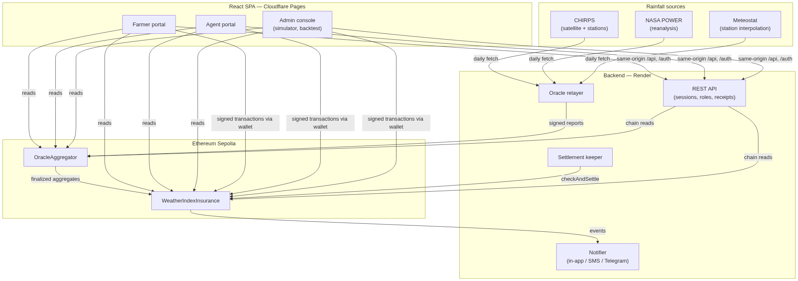

Trust boundaries: the **contracts** are the only components that hold value and are
treated as adversarial-facing (audited, heavily tested); the **backend** is a convenience
and liveness layer — it can delay data but cannot forge a payout, because every number a
payout depends on is reported on-chain by distinct oracle accounts and is publicly
auditable; the **frontend** never holds keys or sessions (the wallet signs, the server
keeps httpOnly sessions).

### 4.2 Smart contract design

**`WeatherIndexInsurance`** holds the policy lifecycle.

- *Coverage windows.* The owner opens windows (`addWindow`) defined as a list of dekad
  period ids and a sales-close timestamp. This project's windows follow the Sokoto
  calendar (e.g. window #19 = Sep D2–Oct D1).
- *Purchase.* `buyPolicy(windowId, droughtThresholdMm, payoutAmount)` requires
  `msg.value == quotePremium(payoutAmount)`, where the premium is 10% of the payout
  (`premiumRateBps = 1000`), rounded up so it is never zero. The contract records
  `farmer = msg.sender`, and reserves the payout immediately: `reservedPayouts` grows by
  the payout amount and `availableCapacity()` (= balance − reserved) enforces that the
  pool can always honour every sold policy. A sale that would over-commit the pool
  reverts.
- *Settlement.* `checkAndSettle(policyId)` is callable by anyone exactly once per policy.
  It reverts until every dekad of the window is finalized in the oracle contract, then
  reads `windowRainfall(windowId)` — the reputation-weighted sum — and either transfers
  the payout to the policy holder (`PayoutTriggered`) or records no payout
  (`PayoutSkipped`). The transfer is a push payment: there is no withdrawal step and no
  claim to file.
- *Administration.* The premium rate can be changed but only affects future quotes;
  ownership moves via a deliberate two-step transfer (`transferOwnership` → `accept`),
  which the audit regression tests pin down.

**`OracleAggregator`** holds the measurement side.

- *Registry.* The owner registers the oracle accounts behind each source label
  (CHIRPS, NASA_POWER, Meteostat) and can retire a compromised account without losing
  its history.
- *Reporting.* Each oracle reports a dekad's rainfall once, after the dekad ends. A
  report is `rainfallMm × 100` (fixed-point, two decimals).
- *Finalization and weights.* When sufficient coverage exists, the dekad finalizes at a
  reputation-weighted aggregate. `weightForPeriod(period, oracle)` exposes the weight
  used per period; `isFinalized` / `finalizedAggregate` expose the outcome. Reputations
  are updated so that sources which agree with their peers gain weight and outliers lose
  it, and changes mid-dekad are ignored (audit finding M-2).

### 4.3 Oracle consensus: reputation weighting

For each finalized dekad, each reporting source receives a weight proportional to its
reputation score, which is updated from its agreement with the other sources' reports.
The design intent is the property the simulator demonstrates (Chapter 6): a single
corrupted feed shifts the **single-source** aggregate by the full corruption, the
**equal-weight** aggregate by one third of it, and the **reputation-weighted** aggregate
by much less — both because the corrupt source is down-weighted immediately and because
its historical weight was already lower if it had drifted before. A source that never
reports simply gets zero weight; the aggregate remains usable (regression-tested).

### 4.4 Backend services

An Express/TypeScript service (deployed on Render) exposes the REST API (Appendix B) and
runs three background roles, all gated so that exactly one instance runs them:

1. **Oracle relayer** — for each ended dekad, fetches daily rainfall for the insured
   point from each source and submits one signed report per source with that source's
   dedicated oracle key. CHIRPS comes from the Climate Hazards Center's daily GeoTIFF
   archive (cached, concurrency-limited), NASA POWER from its JSON API, and Meteostat
   from its RapidAPI point/daily endpoint (with a historical GHCN-series fallback when no
   key is configured). A dekad is only reported once every day of it is covered, because
   the aggregator accepts one report per source per dekad and a partial total could never
   be corrected. Meteostat is deliberately polled at most once per 6 hours to fit its free
   plan's request budget.
2. **Settlement keeper** — when every dekad of a sold policy's window is finalized, it
   calls `checkAndSettle`, retrying through RPC hiccups.
3. **Notifier** — watches new blocks for `PolicyCreated`, `PayoutTriggered` and
   `PayoutSkipped`, and dispatches in-app notifications plus optional SMS (Africa's
   Talking) and Telegram messages to the policy holder (matched by wallet) and operator
   numbers.

Security-relevant API design: sessions are httpOnly, `SameSite=Lax` cookies; the
Cloudflare Pages function proxies `/api` and `/auth` same-origin so that cookie flows on
one origin (Chapter 8); role checks (`requireRole`) run server-side; the agent-receipt
endpoint re-reads the chain and rejects receipts whose premium, payout or window do not
match the on-chain policy; the manual SMS endpoint requires a bearer key compared in
constant time and is rate-limited per hour.

### 4.5 Frontend design

A React + Vite + TypeScript single-page application with three role-based portals
(Farmer, Agent, Admin) sharing an authentication context, an FX context (naira quotes),
a notifications context and a policy context. The policy context has two providers: a
chain provider that reads the deployed contracts through a trusted RPC and submits
wallet-signed transactions, and a simulated provider used when no chain is reachable,
which powers the consensus simulator and the demo mode. Wallet integration is described
in 5.5. The admin console embeds the *oracle research* tools: the consensus simulator
(which re-runs a real dekad under a chosen strategy with one source optionally corrupted)
and the backtest runner over historical seasons.

### 4.6 Data model

On-chain: `CoverageWindow { periods[], salesCloseAt }`, `Policy { farmer, windowId,
droughtThresholdMm, payoutAmount, premiumPaid, settled }`, oracle registry +
per-period reports and weights. Off-chain: users (name, role, LGA, wallet, phone), agent
sales receipts (policy id, farmer, premium/payout in ETH and naira, commission, payment
method and reference, FX rate used, timestamp), sessions, and cached chain reads with
short TTLs. The data-model page in the admin console renders this schema for inspection.

### 4.7 Key sequence flows

**Purchase (agent).** Agent fills the form → the app quotes the premium via Figure 4.2 shows the flow.
`quotePremium` on the trusted RPC → pre-estimates gas and asks the wallet (with an
explicit gas limit and a chain check) to send `buyPolicy` → the contract reserves the
payout and emits `PolicyCreated` → the app saves the agent receipt (verified by the
server against the chain) → farmer and admin are notified.

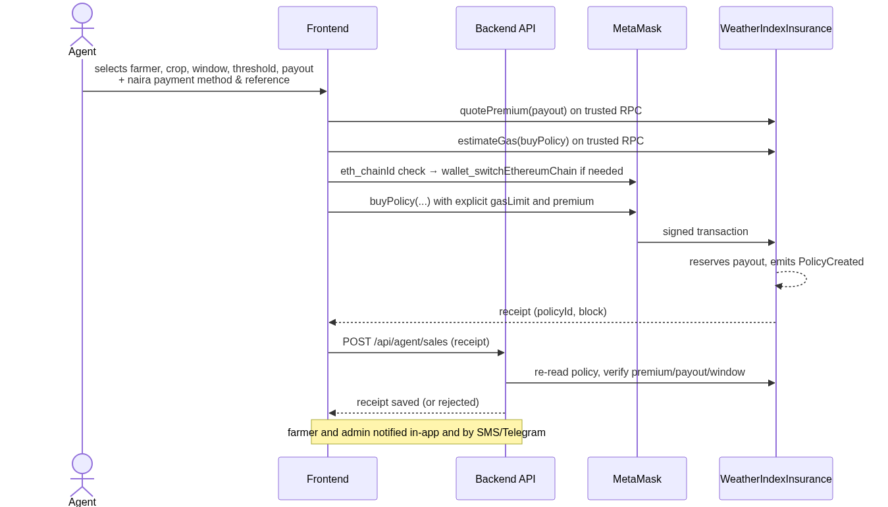

**Report.** Relayer waits for the dekad to end with full source coverage → fetches
daily rainfall from each source → submits one report per source → the aggregator
finalizes the dekad with reputation weights.

**Settlement.** All dekads finalized → settlement keeper calls `checkAndSettle` →
contract compares weighted rainfall to the threshold → pushes the payout to the policy
holder or records no payout → notifier informs farmer and admin → the farmer's Payouts
page shows the amount, outcome and settlement transaction.

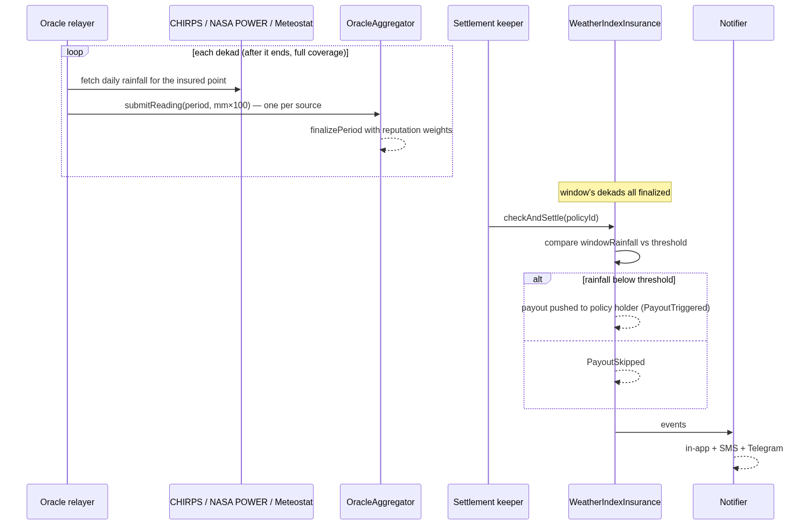

---

## 5. Implementation

### 5.1 Technology stack and rationale

| Layer | Choice | Why |
| --- | --- | --- |
| Contracts | Solidity + Hardhat 3, ethers v6 | industry standard; Hardhat 3's Solidity and TS test layers gave both fuzz tests and integration tests |
| Chain | Ethereum Sepolia | real network behaviour (gas, wallets) with no real-money risk |
| Backend | Node 22, Express, TypeScript | one language across the stack; the relayer needed mature HTTP/RPC tooling |
| Frontend | React + Vite + TypeScript | component ecosystem; strict typing end-to-end (`tsc --noEmit` in CI habits) |
| Hosting | Cloudflare Pages + Render free tier | zero cost, git-push deploys, fits NFR7 |
| Data | CHIRPS, NASA POWER, Meteostat | three structurally different measurement families |

### 5.2 Smart contracts

Both contracts are written to make failure modes explicit: purchases revert on wrong
premium, unknown or closed windows, and on sales the pool cannot cover; reporting reverts
on duplicates and early reports; settlement reverts on unknown, unsettled-again, or
not-yet-finalized policies. Fixed-point rainfall (`mm × 100`) keeps precision in integers.
The premium rounds *up* so it is never zero (regression-tested). Reserves are tracked
explicitly so the invariant *reserves ≤ pool balance* holds — and is fuzz-tested.

### 5.3 Oracle relayer and data sources

The relayer treats each source's quirks as first-class: CHIRPS daily GeoTIFFs are read
for the exact insured pixel with a persistent cache and bounded concurrency; NASA POWER
answers JSON directly; Meteostat lags up to a week and is polled conservatively, falling
back to a bundled historical GHCN series (Birni N'Konni station) when unkeyed. Because
the aggregator accepts exactly one report per source per dekad, the relayer only reports
when every day of the dekad is covered — a partial total could never be corrected, so
late-but-complete beats early-but-partial. RPC submissions go through a retry wrapper so
a transient node failure does not skip a dekad.

### 5.4 Backend API and session security

The API layering is deliberately boring: cached chain reads for anonymous data, cookie
sessions for personal data, role gates for agent/admin actions, and one bearer-keyed
operational endpoint. Receipts written by agents are *verified* server-side against the
chain before storage, so a tampered client cannot inflate commission or fake a sale.

### 5.5 Frontend and wallet hardening

Wallet integration proved the most failure-prone surface of the project, and the fixes
generalise into four rules (full detail in Appendix C):

1. **Trust the chain's RPC for reading and pricing.** Wallet-side RPC endpoints returned
   stale balances ("insufficient funds" for a funded account) and failed gas estimation
   with reasonless errors ("missing revert data"). Reads and quotes now go through the
   app's own RPC, and gas is pre-estimated there and passed to the wallet explicitly.
2. **Never cache wallet state.** The account list captured at page load went stale on
   account switches; the app now follows `accountsChanged`, and a wallet/chain
   disagreement is a warning while the chain's own view decides affordability.
3. **Check the wallet's chain before signing.** A confirmation prepared while MetaMask
   sat on Ethereum mainnet would have sent real ETH to an address holding no code there.
   The app now asks the wallet for its chain, requests a switch (`wallet_switchEthereumChain`)
   on mismatch, and refuses with plain language otherwise.
4. **Errors must name the layer that failed.** Raw ethers jargon is translated into
   actionable sentences (which account, which network, what to do).

### 5.6 Cross-cutting concerns

- **Naira quoting.** An FX context fetches ETH→NGN rates with per-provider fallback and
  degrades to approximate figures with a visible notice — the contract always settles in
  ETH; naira figures are for the farmer conversation.
- **Notifications.** One activity pipeline feeds in-app notifications, SMS templates that
  fit a single 160-character SMS, and an operator Telegram channel.
- **Internationalisation and preferences.** English/Hausa/French strings and a language
  hint to the Google sign-in flow; theme and accessibility preferences persist per user.

---

## 6. Testing and evaluation

### 6.1 Test strategy

Testing is layered so that each failure class is caught where it is cheapest to find:

1. **Solidity unit, integration and fuzz tests** (56) — contract invariants and edge
   cases, run on Hardhat's in-process EVM.
2. **Contract-level integration tests in TypeScript** (13, Mocha) — the application's
   central stories against deployed-in-test contracts, plus the ABI-sync check and audit
   regression tests.
3. **Backend tests** (191 across 25 files, `node:test`) — sessions, auth routes, sale
   verification against the chain, FX fallbacks, SMS templates, caching, the relayer's
   feed handling and backtest statistics.
4. **Frontend tests** (20, Vitest) — policy evaluation logic, formatting and context
   behaviour.

The full suite (`npm run test`) runs every workspace — **280 tests** — and is green.

### 6.2 Smart contract tests (56)

Coverage includes the properties the product's fairness rests on: the premium is exactly
10% of the payout and rounds up so it is never zero; a sale the pool cannot cover reverts
(`test_RefusesSaleThePoolCannotCover`, `test_ReservedPayoutsLimitLaterSales`); reserves
never exceed the pool balance (**fuzzed**, `testFuzz_ReservesNeverExceedPoolBalance`,
256 runs); windows validate; sales close on deadline; a policy pays exactly once
(`test_CannotSettleTwice`) and only after every dekad finalizes
(`test_CannotSettleUntilEveryDekadIsFinalized`); overlapping windows share dekad
reports correctly; and a window whose rainfall meets the threshold pays nothing.

### 6.3 Integration, backend and frontend tests

The Mocha layer covers the end-to-end story ("collects the farmer's premium into the pool
and reserves the payout", "pays out when the window's rainfall is below threshold",
"still reaches a usable, correctly-weighted estimate if one oracle source never
reports"), verifies the frontend ABI still matches the compiled contracts, and pins the
audit fixes (M-1, M-2, L-3, L-5 — see 6.2/7.2). The backend suites exercise the security-
relevant paths hardest: session fixation and cookie flags, role gates, timing-safe API
keys, and — critically — that agent receipts are rejected when their premium, payout or
window do not match the on-chain policy.

### 6.4 Backtest: does reputation weighting help? (2023 and the satellite era)

`docs/backtest-results.md` reports a backtest of the aggregation designs against the
Birni N'Konni rain gauge (GHCN `NG000001075`), 121 dekads 1981–2024 with 81 rainy-season
dekads, comparing NASA POWER and CHIRPS readings at the gauge's location.

**Per-source accuracy (rainy season, mm per dekad):**

| Source | MAE | RMSE | Bias | Correlation |
| --- | --- | --- | --- | --- |
| NASA POWER | 30.3 | 52.4 | −15.9 | 0.34 |
| CHIRPS | 24.4 | 47.4 | −11.8 | 0.50 |

**Combined estimates (out-of-sample weights):** reputation weighting reaches MAE 26.3 mm —
4.0 mm closer to the gauge than NASA POWER alone (95% bootstrap CI −6.4 to −1.7), 0.3 mm
closer than equal weights (CI −0.5 to −0.1), and 1.9 mm further than the best single
source (CHIRPS). The honest reading: **combining sources guards against the weaker feed
without knowing in advance which one is weaker, at a small accuracy cost versus the best
source** — exactly the insurance trade-off the design aims for, since the risk being
hedged is a *corrupted or failing* source, not average noise.

**Payout decisions (basis risk).** Against the gauge's dry dekads, single sources miss
25–50% of droughts and pay 15% false payouts; the combined estimates agree with the
gauge on 78–79% of calls and cut false payouts to 13%. Basis risk at dekad scale is real
and is stated as a limitation (Chapter 9).

**Robustness demo (consensus simulator).** Corrupting one source's reading (NASA POWER
inflated ×2.5) moves the single-source aggregate by the full corruption and the
equal-weight aggregate by **+59%**, while the reputation-weighted aggregate moves **+9%**
— the property FR10 asks for, demonstrated on real dekad data (Appendix A,
`07-consensus-simulator`).

### 6.5 Evaluation against the objectives

| Objective | Evidence | Status |
| --- | --- | --- |
| O1 contract system selling, reserving and auto-settling policies | 56 Solidity + 13 integration tests; live Policy #0 bought and paid out autonomously | met |
| O2 reputation-weighted multi-source aggregation | OracleAggregator weights; simulator (+9% vs +59%); backtest (6.4) | met |
| O3 automated data pipeline | relayer reporting 3 sources live; settlement keeper executed the live payout | met |
| O4 role-based web app with wallet integration | three portals; agent receipts verified server-side; wallet hardening (5.5) | met |
| O5 evaluation via tests, audit, backtest | 280 green tests; audit (Ch. 7); backtest (6.4) | met |

---

## 7. Security and auditing

### 7.1 Method

A manual audit (documented in `docs/security-audit.md`) reviewed both contracts for the
OWASP-class smart-contract risks (access control, reentrancy, oracle manipulation,
economic attacks, griefing), the dependency tree for known advisories, and the deployment
and key-handling practices. Each finding carries a severity, an affected location and a
resolution status; resolved findings gained regression tests so they cannot silently
return.

### 7.2 Findings and resolutions

| ID | Severity | Finding | Status |
| --- | --- | --- | --- |
| H-1 | High | Fully centralised admin: owner controls payouts, oracles and weights | documented risk; mitigated by two-step ownership + public on-chain state (see 9) |
| H-2 | High | Settlement could occur arbitrarily late | partly resolved 2026-10-14; keeper automation reduces the window |
| H-3 | High | `serialize-javascript` RCE advisory (dev dependency) | resolved 2026-09-28 |
| M-1 | Medium | Finalization race: a half-reported period could be finalized early | resolved 2026-09-30 — quorum enforced; regression: "won't let one source finalize an extreme early reading into a payout" |
| M-2 | Medium | Owner could rewrite reputation weights after readings are in | resolved 2026-09-30 — mid-dekad weight changes ignored; regression-tested |
| M-3 | Medium | Reentrancy griefing of the payout pool at funding time | documented; reserves accounting (M-4) bounds the impact |
| M-4 | Medium | Payouts silently skipped when the pool was underfunded | resolved 2026-09-28 — reserve accounting at purchase |
| M-5 | Medium | No sanity bounds on submitted rainfall readings | resolved 2026-10-27 |
| L-1…L-6 | Low | finalize-period edge case, division truncation, owner-key custody, key hygiene, oracle deregistration, npm advisories | L-3 partly resolved (two-step ownership regression-tested), L-4 resolved, L-5 resolved (compromised source can be retired without losing history — regression-tested); L-6 tracked |

The regression suite is the audit's long arm: tests named for M-1, M-2, L-3 and L-5
execute the fixed behaviour on every run.

### 7.3 Application and operational security

- **Sessions.** httpOnly, `SameSite=Lax` cookies; no tokens in JavaScript-reachable
  storage; the Pages function proxies API and auth on one origin so the cookie never
  crosses sites (the alternative — `SameSite=None` — would have given up CSRF protection).
- **Authorisation.** Role checks are server-side on every agent/admin route.
- **Input and abuse.** JSON bodies capped at 10 KB; the manual SMS endpoint requires a
  bearer key compared in constant time and is rate-limited per hour; Turnstile CAPTCHA
  guards authentication endpoints, verified server-side.
- **Receipt integrity.** Agent sale receipts are validated against the on-chain policy
  before storage, so a tampered client cannot inflate commission or fabricate sales.
- **Wallet-side hardening.** The purchase path distrusts wallet RPC state (stale balances,
  reasonless estimation failures), refuses to sign on the wrong chain, and translates
  errors into actionable text (5.5). A mis-configured wallet can no longer silently fail
  or misroute a real-value transaction.
- **Key management.** Secrets live only in per-service environment variables (Render,
  Pages); the deployer key uses Hardhat's encrypted keystore; no key appears in the
  repository.

---

## 8. Deployment and operations

### 8.1 Topology

| Component | Host | URL / address |
| --- | --- | --- |
| Frontend + same-origin API proxy | Cloudflare Pages | `https://sokoto-cover.pages.dev` |
| API, oracle relayer, settlement keeper, notifier | Render web service (free tier) | `https://sokoto-cover-api.onrender.com` |
| `WeatherIndexInsurance` | Ethereum Sepolia | `0x8520A0697D018a380a91CB65096AB50F5B65D6D5` |
| `OracleAggregator` | Ethereum Sepolia | `0x1b595A484A0a26eaC8764307c19bbfDaA2E4aDE1` |

Both web tiers deploy from `main` on push. Contracts were deployed with Hardhat
Ignition; the deployer key lives in Hardhat's encrypted keystore, never in the
repository.

### 8.2 Configuration

Service configuration is environment-only (per-service `.env` locally, dashboard
environment variables in production), documented in `docs/deployment.md`: chain RPC and
contract addresses on the frontend; session secret, database paths, chain RPC and oracle
private keys, rainfall coordinates, data-source keys and notification credentials on the
backend. A Cloudflare Pages function proxies `/api` and `/auth` to Render on the same
origin — the design decision that keeps the `SameSite=Lax` session cookie flowing while
preserving CSRF protection.

### 8.3 Operations

Exactly one backend instance runs the relayer, settlement keeper and notifier
(`RELAYER_ENABLED`). The relayer reports each dekad once its data is complete, Meteostat
at most once per six hours to respect its free plan; FX rates refresh with per-provider
fallback and the UI degrades to approximate naira figures when both providers are
unavailable (Render's free tier sleeps, and every consumer of its data tolerates that).
Monitoring is deliberately lightweight for a prototype: an external uptime check on
`/health`, structured console logs, and Telegram/SMS operator notifications for policy
activity. Two operational hardening items are listed in Chapter 9 (npm advisory backlog,
owner-key custody).

---

## 9. Discussion, limitations and future work

### 9.1 What the evaluation shows

The backtest supports the design honestly rather than triumphantly: reputation weighting
is **not** more accurate than the best single source on average — it is 1.9 mm per dekad
worse than CHIRPS — but it is significantly better than the weaker source and than equal
weights, and, crucially, it is the design that survives a *failing* source: the simulator
shows a corrupted feed moving the payout-relevant aggregate by 9% under reputation
weights versus 59% under equal weights. For an insurance product whose risk is a wrong
number, robustness is the right optimisation target. The deployed weights (CHIRPS 421,
NASA 268, Meteostat 311) sit near the backtest's inverse-MSE recommendation (CHIRPS 550,
NASA 450).

### 9.2 Limitations

- **Basis risk is substantial.** Every estimate misses 45–50% of the gauge's dry dekads
  at dekad scale; farmers can suffer a dry spell the index does not see. Shorter windows
  or field-level data would reduce this.
- **One gauge, one location.** Accuracy evidence comes from one station 83 km from the
  insured point, and the platform covers a single coordinate.
- **Prototype money.** Settlement is testnet ETH; the naira leg is receipted but
  off-chain. In the agent model the payout reaches the buying wallet and the agent
  settles with the farmer in naira — a production version should pay the farmer's wallet
  directly or integrate a fiat off-ramp.
- **Administrative trust remains** (audit H-1): the owner controls windows, oracles and
  weights. Mitigations (public state, two-step ownership) reduce but do not remove it;
  a multisig or timelock is the obvious next step.
- **Dependency advisory backlog** (audit L-6) must be cleared before any real-money use.

### 9.3 Future work

1. Pay the farmer's own wallet as beneficiary in the agent flow (or embed a fiat off-ramp).
2. Owner key → multisig/timelock; progressive decentralisation of the oracle registry.
3. Multi-location and multi-index products (rainfall windows, heat, flood), per-LGA pricing.
4. Mobile-money and USSD access for farmers without smartphones.
5. More sources and satellite products (e.g. TAMSAT, GPM IMERG) to tighten consensus.
6. Mainnet deployment economics: gas sponsorship or an L2, stablecoin premiums.

---

## 10. Conclusion

Sokoto Rainfall Cover demonstrates that weather-index insurance for smallholder farmers
can be settled by code rather than institutions: premiums are collected and reserved on a
public blockchain, rainfall is measured by three independent sources whose agreement —
not any one reading — decides the payout, and payment is an automatic transfer at the end
of the coverage window, with no claim to file. The engineering evidence is a tested
(280 green tests), audited (findings fixed and regression-pinned), deployed system whose
central economic behaviour — buy, measure, pay — has run live on Sepolia from purchase to
payout without human intervention. The evaluation is equally honest about what remains:
basis risk is real, administrative trust is reduced but not eliminated, and the naira leg
is a receipt rather than a rail. Within those limits, the project answers its core
question — *can a farmer trust the rainfall number?* — the way it deserves to be
answered: not by asking for trust, but by making the measurement public, plural and
auditable.

---

## References

Buterin, V. (2014). *Ethereum: A next-generation smart contract and decentralized
application platform.* https://ethereum.org/en/whitepaper/

Breidenbach, L., Daian, P., Juels, A., & Sirer, E. G. (2021). *Chainlink 2.0: An
expansion of hybrid smart contracts.* https://chain.link/whitepaper-v2

Etherisc. (2017). *Etherisc: Decentralized insurance protocol* (Whitepaper).

Funk, C., Peterson, P., Landsfeld, M., Pedreros, D., Verdin, J., Shukla, S., Husak, G.,
Rowland, J., Harrison, L., Hoell, A., & Michaelsen, J. (2015). The climate hazards
infrared precipitation with stations — a new environmental record for monitoring
extremes. *Scientific Data, 2*, 150066. https://doi.org/10.1038/sdata.2015.66

Greatrex, H., Hansen, J., Garvin, S., Diro, R., Blakeley, M., Le Guen, M., Rao, K., &
Osgood, D. (2015). *Weather index insurance for agriculture: Past, present and future*
(Working Paper). CGIAR Research Program on Climate Change, Agriculture and Food Security.

Halaburda, H., He, G., & Miklósi, G. (2020). *Blockchain and the oracle problem*
(SSRN working paper). https://papers.ssrn.com/

Hazell, P., Anderson, J., Balzer, N., Hastrup Clemmensen, A., Hess, U., & Rispoli, F.
(2010). *The potential for scale and sustainability in weather index insurance for
agriculture and rural livelihoods.* International Fund for Agricultural Development /
World Food Programme.

Jensen, N. D., & Barrett, C. B. (2017). Agricultural index insurance for development.
*Applied Economic Perspectives and Policy, 39*(2), 199–219.
https://doi.org/10.1093/aepp/ppw016

Meteostat. (2026). *Meteostat JSON API documentation.* https://dev.meteostat.net/api

Sparks, A. H. (2018). nasapower: A NASA POWER Global Meteorology, Surface Solar Energy
and Climatology Data Client for R. *The Journal of Open Source Software, 3*(30), 1035.
https://doi.org/10.21105/joss.01035

Nakamoto, S. (2008). *Bitcoin: A peer-to-peer electronic cash system.*

OpenZeppelin. (2026). *Contracts: Secure smart contract library.* https://docs.openzeppelin.com/contracts

World Food Programme. (2024). *R4 Rural Resilience Initiative.* https://www.wfp.org

*(Software documentation cited in text: Hardhat — https://hardhat.org; ethers.js —
https://docs.ethers.org; React — https://react.dev; Express — https://expressjs.com.
Verify all entries against your department's APA 7 referencing guide before submission.)*

---

## Appendix A: Figures and screenshots

Screenshots are in `docs/screenshots/` (captured 29 October 2026; live-chain shots read
Sepolia, simulated shots run the consensus tooling):

```{=openxml}
<w:p><w:r><w:br w:type="page"/></w:r></w:p>
```

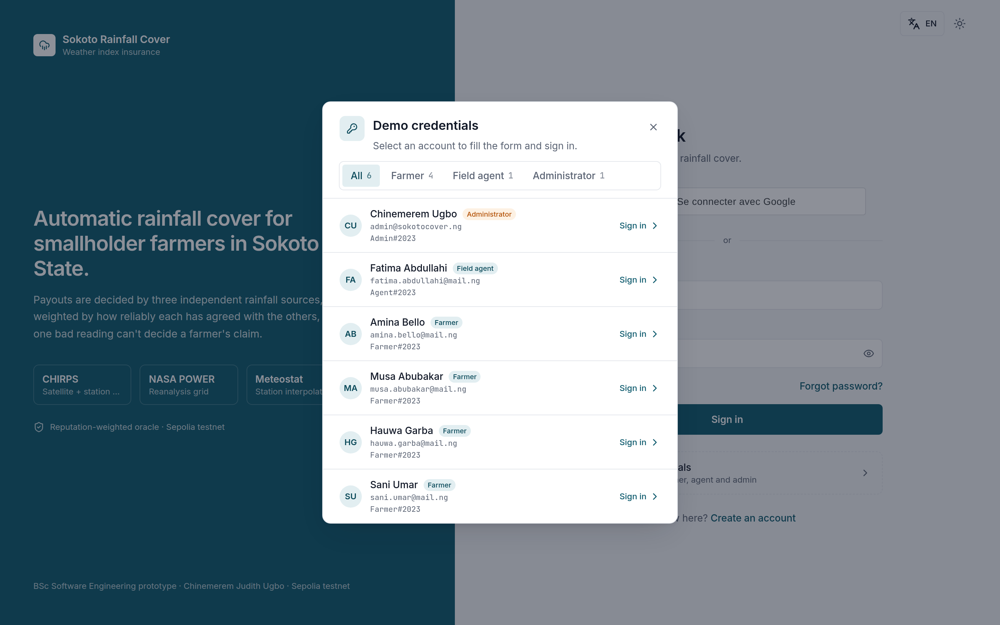{width=6.3in height=3.94in}

*Figure A.1 — Sign-in page with the demo-credentials panel (`01-sign-in.png`)*

```{=openxml}
<w:p><w:r><w:br w:type="page"/></w:r></w:p>
```

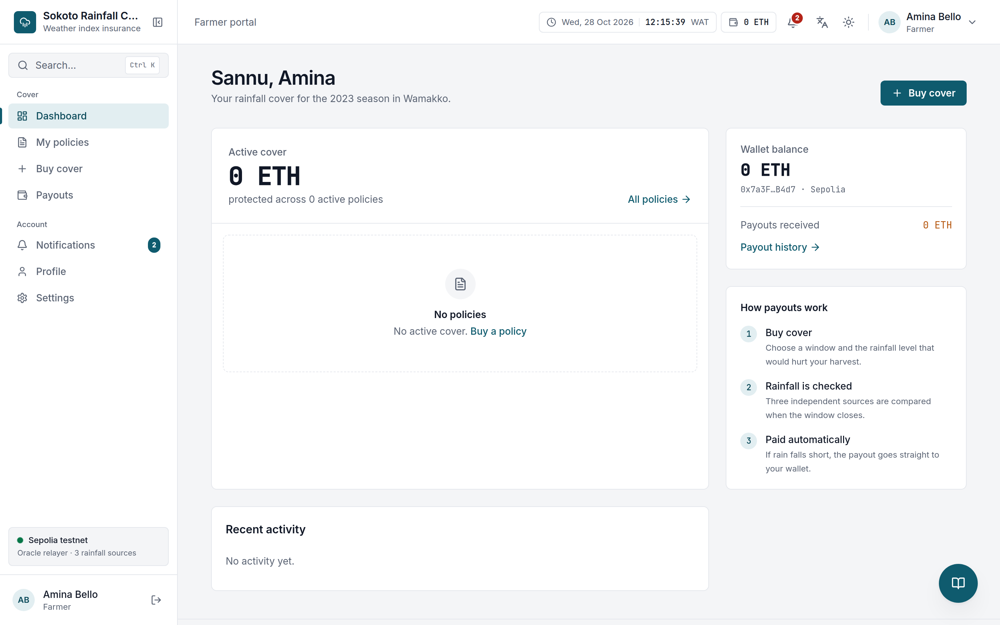{width=6.3in height=4.61in}

*Figure A.2 — Farmer dashboard (simulated data mode) (`02-farmer-dashboard.png`)*

```{=openxml}
<w:p><w:r><w:br w:type="page"/></w:r></w:p>
```

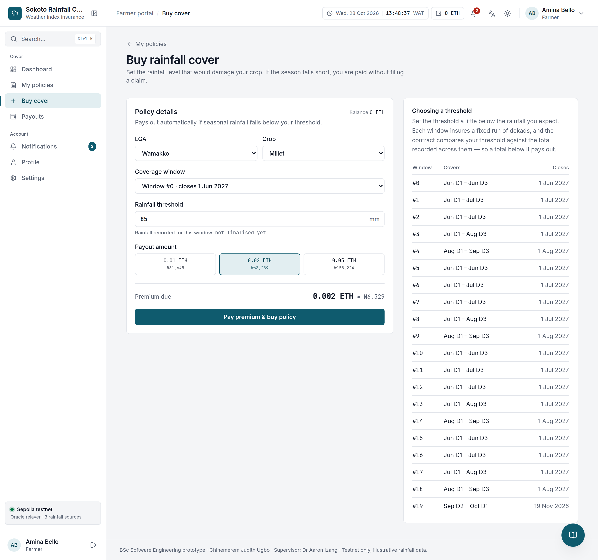{width=6.3in height=5.91in}

*Figure A.3 — Buy cover: coverage window, rainfall threshold and payout selection (`03-buy-cover.png`)*

```{=openxml}
<w:p><w:r><w:br w:type="page"/></w:r></w:p>
```

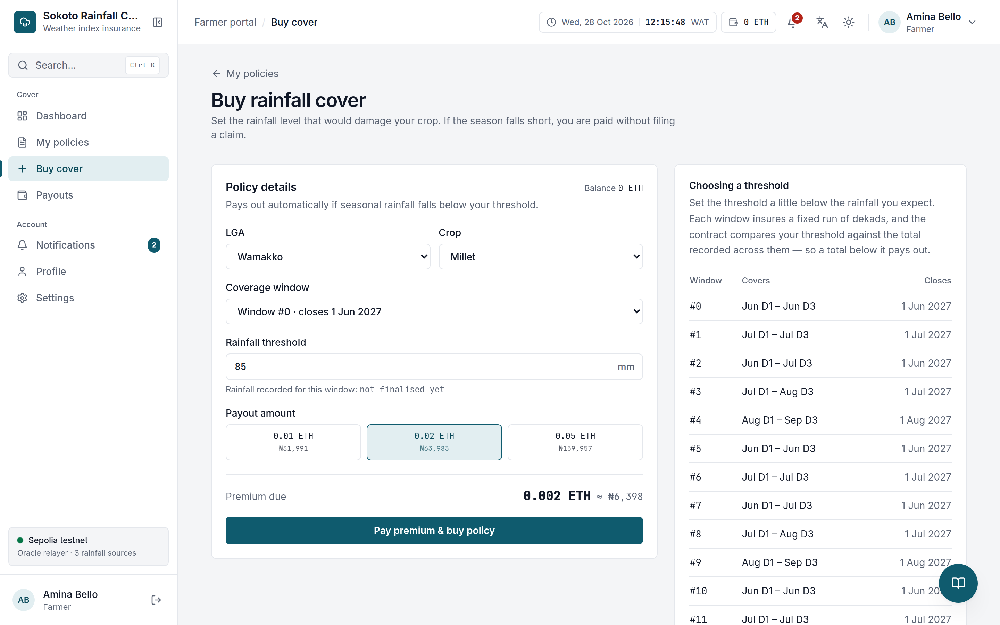{width=6.3in height=5.56in}

*Figure A.4 — Policy #0 — bought 29 Oct 2026, settled and paid out; oracle evaluation and settlement transaction (`04-policy-detail.png`)*

```{=openxml}
<w:p><w:r><w:br w:type="page"/></w:r></w:p>
```

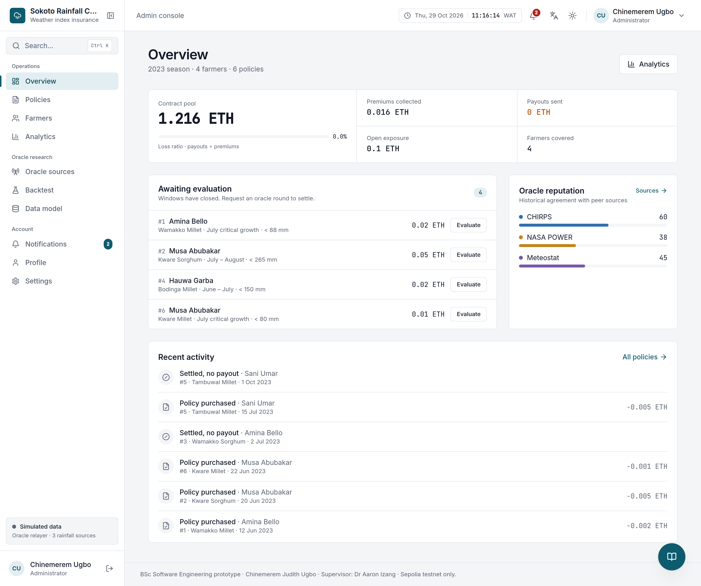{width=6.3in height=5.27in}

*Figure A.5 — Administrator overview (`05-admin-overview.png`)*

```{=openxml}
<w:p><w:r><w:br w:type="page"/></w:r></w:p>
```

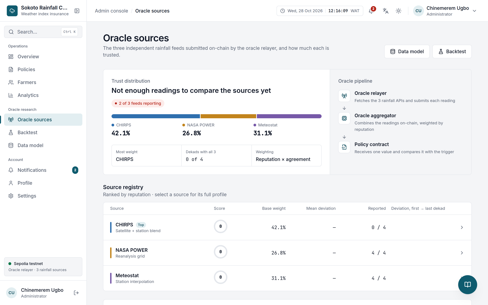{width=6.3in height=7.28in}

*Figure A.6 — Oracle sources and reputation weights (`06-oracle-sources.png`)*

```{=openxml}
<w:p><w:r><w:br w:type="page"/></w:r></w:p>
```

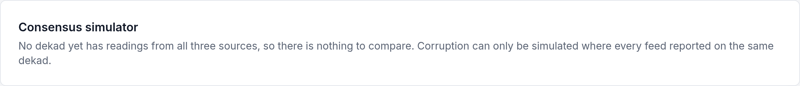{width=6.3in height=2.07in}

*Figure A.7 — Consensus simulator with one source corrupted (NASA POWER inflated ×2.5) (`07-consensus-simulator.png`)*

```{=openxml}
<w:p><w:r><w:br w:type="page"/></w:r></w:p>
```

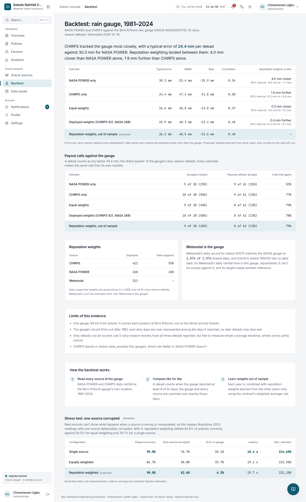{width=4.64in height=7.6in}

*Figure A.8 — Backtest of aggregation designs against historical rainfall (`08-backtest.png`)*

```{=openxml}
<w:p><w:r><w:br w:type="page"/></w:r></w:p>
```

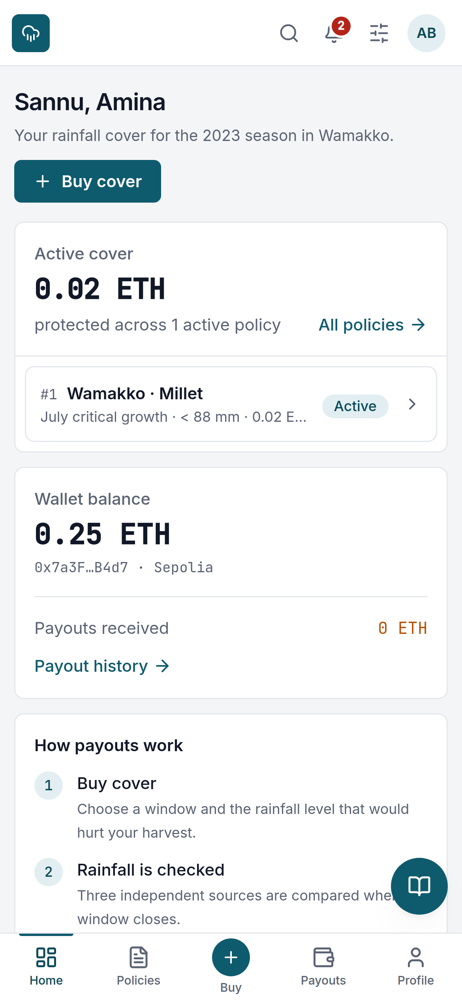{width=3.51in height=7.6in}

*Figure A.9 — Mobile layout of the farmer dashboard (`09-mobile.png`)*

```{=openxml}
<w:p><w:r><w:br w:type="page"/></w:r></w:p>
```

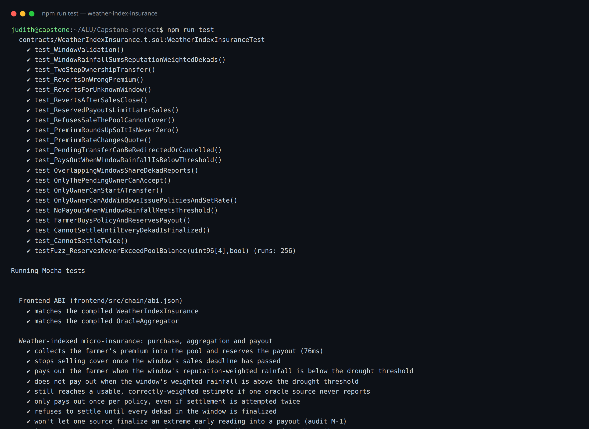{width=6.3in height=5.63in}

*Figure A.10 — `npm run test` — 69 passing (56 Solidity, 13 Mocha) in the blockchain workspace (`10-tests.png`)*

Figures 4.1–4.3 are rendered in `docs/figures/` as PNG and SVG, with Mermaid sources
(`architecture.mmd`, `sequence-purchase.mmd`, `sequence-settlement.mmd`) alongside them.

## Appendix B: Endpoints

**Auth (`/auth`):** `GET session` · `POST login` · `POST register` · `POST google` ·
`POST verify-email` · `POST resend-verification` · `POST reset/request` ·
`POST reset/confirm` · `POST password` · `PATCH profile` · `DELETE account` · `POST logout`

**Data (`/api`):** `GET policies` · `GET oracles` · `GET windows` · `GET pool` ·
`GET settlements` · `GET readings` · `GET evaluations` · `GET fx` ·
`GET users/directory` · `GET demo-credentials` · `GET agent/sales` ·
`GET agent/sales/:policyId` · `POST agent/sales` · `POST notify/sms`

**Ops:** `GET /health`. The Pages function proxies `/api` and `/auth` same-origin.

**Contract (WeatherIndexInsurance):** `buyPolicy` · `quotePremium` · `checkAndSettle` ·
`windowRainfall` · `policies` · `getCoverageWindow` · `availableCapacity` · owner
functions (`addWindow`, `setPremiumRate`, two-step `transferOwnership`).
**OracleAggregator:** oracle registry (`registerOracle`, retire), `submitReading`,
`finalizePeriod`, `isFinalized`, `finalizedAggregate`, `weightForPeriod`.

## Appendix C: Debugging journal (summary)

The full journal is `docs/debugging-journal.md`. In summary, live purchases initially
failed in the wallet layer with four distinct faults — gas estimation routed through a
failing wallet RPC ("missing revert data"), a stale wallet balance view ("insufficient
funds" for a funded account), a stale account list after account switches, and a wallet
sitting on the wrong network preparing a real-ETH transfer — while the contract accepted
the call at every point. Fixes: estimate gas on the app's trusted RPC and pass it
explicitly; treat the chain's view as authoritative; follow `accountsChanged`; check the
wallet's chain and request a switch before signing; translate all of it into
plain-language errors. The episode is the strongest argument in the project for treating
wallet infrastructure as untrusted input.

## Appendix D: Licences

The project is MIT-licensed (`LICENSE`). Third-party components and their licences are
listed in `docs/licenses.md` (data sources: CHIRPS, NASA POWER, Meteostat — attribution
required; software: React, ethers.js, Hardhat, OpenZeppelin-derived patterns, Express).
Meteostat data is used under its open licence with attribution; redistribution of raw
data is not permitted commercially.
